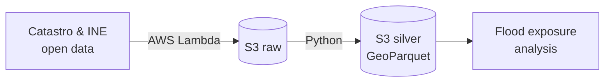

<h1 align="center">Hi, I'm Javier Roma 👋</h1>
<h3 align="center">Geospatial Data Engineer · FME Expert · PostGIS & Python · AWS</h3>

Madrid, Spain · Remote · In GIS since 2010

  
  

---

### 🧭 About me
I build **reliable pipelines for spatial data**. After 15+ years turning maps into decisions, I now focus on the work behind them: loading, converting, validating and publishing geospatial data, from desktop GIS to PostGIS and the cloud.

- 🔁 Automating manual GIS workflows with **FME** and **Python**
- 🗄️ Designing and loading **PostGIS** databases with quality control
- ☁️ Moving spatial data to **AWS** in cloud-native formats (GeoParquet)
- 📱 Connecting field data (**QField**, Survey123) to central databases

---

### 🚀 Featured project: [spain-flood-exposure](https://github.com/jaromaco/spain-flood-exposure)
Pipeline that measures building and population exposure to floods in Valencia using open data.

